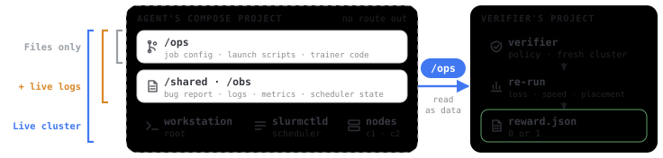
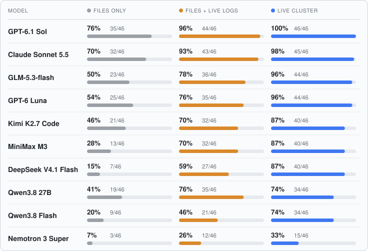

# BrokenML

[](https://doi.org/10.5281/zenodo.23317808)

How much access does an agent need to fix a broken ML workload? BrokenML puts that question to nine models with 46
broken distributed ML jobs and three levels of access: the configuration files and code only, the files plus live
logs, or the live cluster itself.

**Read the write-up: [Agents against broken ML workloads](https://zhebrak.io/posts/brokenml/).**

Each task is a real job running in Docker Compose, either PyTorch training over Gloo on a two-node Slurm cluster or
a llama.cpp inference server, with a single injected fault that stops it from meeting its spec. The agent's job is to
find the mechanism and repair the system through `/ops`. A separate verifier then re-runs the job on a fresh cluster
with fresh data and checks that it completes, that its held-out loss is within bound, that placement is correct and,
where speed was the fault, that throughput matches a reference. Tasks use the
[Harbor](https://github.com/harbor-framework/harbor) format.

<picture>
  <source media="(prefers-color-scheme: dark)" srcset="docs/figures/task-environment-dark.svg">
  
</picture>

## Leaderboard

Tasks solved out of 46 in each access regime, one run per task.

<picture>
  <source media="(prefers-color-scheme: dark)" srcset="docs/figures/leaderboard-dark.svg">
  
</picture>

Every row is Terminus 2 on Harbor 0.23.0 with reasoning effort high, on dataset 0.1.0. The analysis is in
[`docs/report/findings.md`](docs/report/findings.md) and the counting rules in [`docs/leaderboard.md`](docs/leaderboard.md).

## What this does not show

The faults are injected. 15 of the 46 test tasks reproduce a specific public issue and the rest come from failure
classes described in reports or documentation, but none is an incident lifted from a production fleet.

Everything ran on CPUs with Gloo. No agent touched a GPU. A handful of mechanisms were cross-checked on two H100s with
NCCL ([`docs/fidelity.md`](docs/fidelity.md)), and the `tasks/gpu` split is unvalidated.

Each cell is one run. The intervals describe which tasks were drawn, not run-to-run noise, and a single agent harness
(Terminus 2) carried every run.

Two models shaped the tasks. They were developed and hardened against Claude Sonnet 5.5 and Qwen3.8 27B, so those
two rows are the least independent of the task design. Everything else that touches a score is in
[`docs/report/known-issues.md`](docs/report/known-issues.md).

## Quick start

You need a Linux host with Docker and Compose v2, [uv](https://docs.astral.sh/uv/) and Harbor 0.23.0
(`uv tool install harbor==0.23.0`). `uv run bench doctor` checks all of them.

```bash
make image-pull                              # the study's images from GHCR, tagged for local use (or: make image, to rebuild)
make tasks                                   # render tasks/ from families/ and templates/
make smoke                                   # dev split: the reference fix scores 1, doing nothing scores 0 (about 35 minutes)
make reproduce-task TASK=tiny-ddp-buckets    # one test task on your host: doctor, oracle, nop (about 10 minutes)
cp .env.example .env                         # provider keys for the agent (gitignored)
uv run bench run <model> --split dev         # a model on the dev split; add --variant logs or ablation for the others
```

### Images

The study's images are on GHCR and listed in [`images/study-images.json`](images/study-images.json). `make image-pull`
fetches them by digest, and `bench doctor` tells you whether your local images are the study's. `make image` rebuilds
them from source instead; rebuilt images get different ids, so runs on them are kept apart from the study's rows
([`docs/scored-runs.md`](docs/scored-runs.md)). The study runtime has a Slurm defect: a fix that submits with
`sbatch --export=ALL,VAR=x` crashes a node at grading. Grade such runs with the patched runtime,
`ghcr.io/zhebrak/brokenml-runtime:0.1.0-getenvfix`, as the study's re-grades were
([`docs/report/known-issues.md`](docs/report/known-issues.md), the Slurm issue).

### Host

A full pass of one model is 138 trials of up to 30 minutes each. The study host (32 vCPUs, 64 GB, fast disk) measured
8 concurrent trials as safe, which makes a pass 3 to 8 hours depending on the endpoint's speed; `bench concurrency`
measures your host. Keep it otherwise quiet, since throughput rules compare two timed runs. Setup and sizing are in
[`docs/hosts.md`](docs/hosts.md).

## Add a row

1. Run all 46 test tasks in the three variants under the rules in [`docs/leaderboard.md`](docs/leaderboard.md):
   `uv run bench run <model> --split test --variant standard`, then `--variant logs` and `--variant ablation`.
   Add `--reasoning-effort high` to match the board.
2. Run `uv run bench analyze runs/jobs --prefix <job name prefix> --zeroed results/study/zeroed.yaml`.
3. Open an issue with the "Leaderboard row" template and attach the job directories.

Reference fixes are public by design; grading does not rely on secrecy. Every task file carries a canary GUID so the
tasks can be filtered out of training corpora.

## Repository map

| Path | What it holds |
|---|---|
| `families/` | Task sources: `spec.yaml`, the fault patch, the reference fix and the scripted wrong fixes |
| `templates/` | The base `/ops` repositories the tasks start from (training, GPU, serving) |
| `tasks/` | Rendered Harbor tasks (`test`, `dev`, `gpu`); never edited by hand |
| `images/` | Runtime, harness and engine images, and the runtime with the Slurm fix |
| `src/ocb/` | The platform library the agent can reach (`ocb` CLI, metrics, Slurm helpers) |
| `src/harness/` | Provisioning, object store and verifier; only in the harness image |
| `src/bench/` | Authoring, QA and run tooling (host only): `bench render`, `qa`, `run`, `analyze` |
| `tools/` | Dataset, report and figure generation, the audits behind the report, host scripts |
| `results/` | Stamped records and the study dataset (`results/study/`) |
| `docs/` | Design, rules, hosts and the report (`docs/report/`) |
| `calibration/` | The legitimate variants and shortcuts that thresholds come from |
| `experiments/` | The GPU/NCCL fidelity experiments |
| `protocol/` | Frozen run schedules, settings and re-grade records |

`make check` runs lint, types, shellcheck and the unit tests without Docker (on a minimal Ubuntu image install
`libatomic1` first; pyright's node needs it).

## Related work

- SREGym ([2605.07161](https://arxiv.org/abs/2605.07161)) and Incident-Arena ([2610.00648](https://arxiv.org/abs/2610.00648)): live repair of web applications in Kubernetes.
- InfraBench ([2608.11234](https://arxiv.org/abs/2608.11234)): generic infrastructure incidents, with one Slurm admin task.
- Terminal-Bench: two single-container training-debugging tasks ([pretrain-shard-corruption](https://github.com/harbor-framework/terminal-bench/tree/main/tasks/pretrain-shard-corruption), [vpp-loss-divergence](https://github.com/harbor-framework/terminal-bench/tree/main/tasks/vpp-loss-divergence)).
- AI Infra Bench, SWE-Serve ([2609.26777](https://arxiv.org/abs/2609.26777)) and Φ-Bench ([2609.10226](https://arxiv.org/abs/2609.10226)): code patches and speedups in serving systems and kernels.

## Citation

If you use BrokenML, please cite the dataset version you used:

```bibtex
@misc{zhebrak2026brokenml,
  author       = {Zhebrak, Alex},
  title        = {{BrokenML}: Benchmarking agents repairing broken distributed ML jobs},
  year         = {2026},
  url          = {https://github.com/zhebrak/brokenml},
  doi          = {10.5281/zenodo.23317808},
  note         = {Dataset version 0.1.0: 46 broken training and serving jobs, nine models, three access regimes}
}
```

## License

Apache-2.0 ([`LICENSE`](LICENSE)). Third-party software in the images is listed in
[`THIRD_PARTY_NOTICES.md`](THIRD_PARTY_NOTICES.md).
